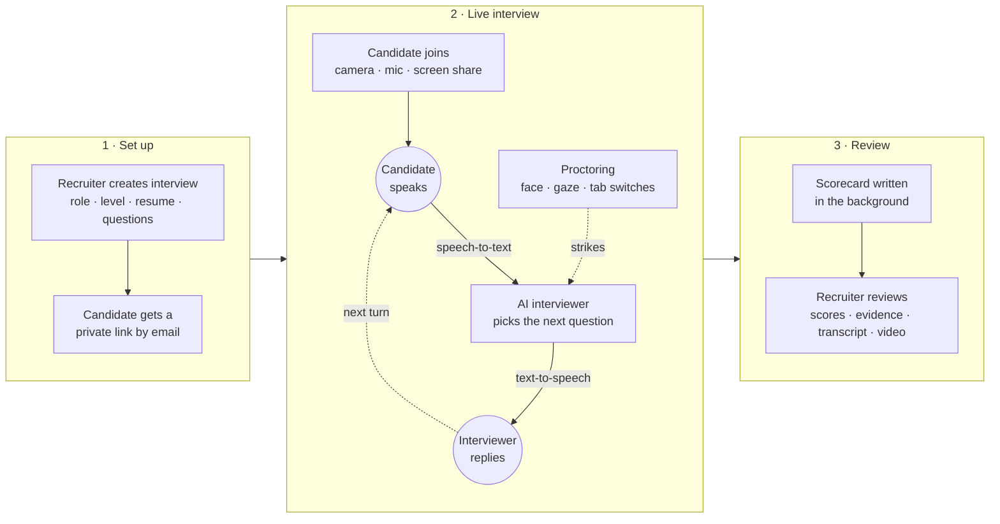

<p align="center">
  
  
  
  
</p>

<h1 align="center">AI Interview Platform</h1>

<p align="center">
  Voice and video interviews run by an AI interviewer, with live proctoring and automatic scorecards.
  <br />
  Maintained by <a href="https://github.com/agents-adityaupadhyay">Aditya Upadhyay</a>.
</p>

<p align="center">
  <a href="docs/getting-started.md">Getting started</a> &nbsp;&middot;&nbsp;
  <a href="docs/configuration.md">Configuration</a> &nbsp;&middot;&nbsp;
  <a href="docs/architecture.md">Architecture</a> &nbsp;&middot;&nbsp;
  <a href="docs/api.md">API</a> &nbsp;&middot;&nbsp;
  <a href="CHANGELOG.md">Changelog</a>
</p>

## How it works



| Phase | What happens |
|-------|--------------|
| **1 · Set up** | The recruiter picks the role, seniority and duration, attaches the resume and optional question bank. The candidate receives a private link. |
| **2 · Live interview** | The candidate talks to the AI in the browser. Each answer is transcribed, the AI decides what to ask or follow up on, and the reply is spoken back sentence by sentence. Proctoring runs throughout and the server counts strikes. |
| **3 · Review** | When the AI wraps up, time runs out, someone ends the call or the strike limit is reached, a scorecard is generated with quotes from the transcript as evidence, then shown on the dashboard with the proctoring timeline and recording. |

For the technical view, see [Architecture](docs/architecture.md).

## Features

| Interview | Integrity | Review |
|-----------|-----------|--------|
| Natural voice conversation (speech-to-text → AI → text-to-speech) | Face, gaze and extra-device detection | Scorecard across 5 dimensions with quoted evidence |
| Domain-aware (Tech, HR, Sales, Ops, CX, PM, Design, Data, Finance) | Tab / window switch detection | Level-calibrated scoring (Intern → Director) |
| Level-aware, time-aware pacing | Mandatory screen share and fullscreen | Proctoring report and periodic photos |
| Resume-based follow-ups and custom question banks | Server-enforced strike limit | Side-by-side candidate comparison |
| Coding interview mode (Monaco editor) | Copy / paste blocking | Optional camera + mic video playback |

It is multi-tenant (organizations, admins and members), works with **any OpenAI-compatible model**, and lets you pick from several speech providers (Deepgram, Cartesia, ElevenLabs, Sarvam, Soniox, and free Edge TTS).

## Quick start

```bash
git clone https://github.com/agents-adityaupadhyay/ai-interview-portal.git
cd ai-interview-portal
cp .env.example .env.local        # fill in NEXTAUTH_SECRET, AI_API_KEY, DEEPGRAM_API_KEY
docker compose --env-file .env.local up -d --build
```

Open http://localhost:3000. This starts the app plus a bundled Postgres with the schema already applied. For local development without Docker, an external database, and creating the first admin account, see **[Getting started](docs/getting-started.md)**.

## Documentation

| Guide | What's in it |
|-------|--------------|
| [Getting started](docs/getting-started.md) | Local setup, database, first admin account |
| [Configuration](docs/configuration.md) | Every environment variable, AI models, voice and speech providers |
| [Architecture](docs/architecture.md) | How the pieces fit together, interview lifecycle, security model |
| [AI assistant](docs/ai-assistant.md) | Recruiter chat agent: features, approvals, adding capabilities, milestones |
| [API reference](docs/api.md) | Pages and API routes |
| [Deploy with GitHub Actions](docs/deployment/github-actions.md) | CI image build to GHCR and SSH deploy to a Docker host |
| [Deploy to OpenShift](docs/deployment/openshift.md) | Template-based deploy with `oc` |

## Roadmap

Planned features will be listed here and released as new versions. See the [changelog](CHANGELOG.md) for what has shipped.

## Contributing

Issues and pull requests are welcome at [agents-adityaupadhyay/ai-interview-portal](https://github.com/agents-adityaupadhyay/ai-interview-portal/issues).

## License

Released under the [MIT License](LICENSE).
